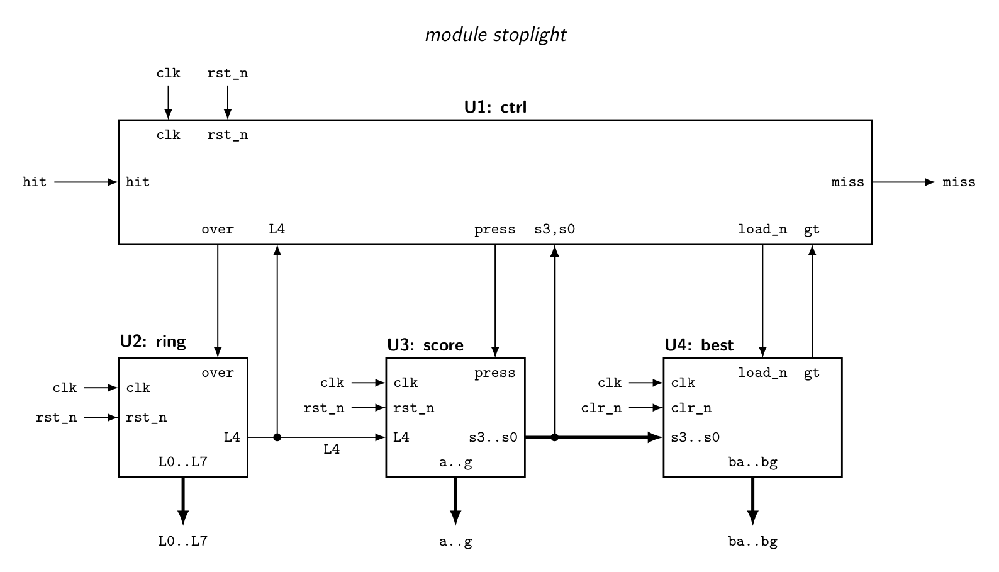
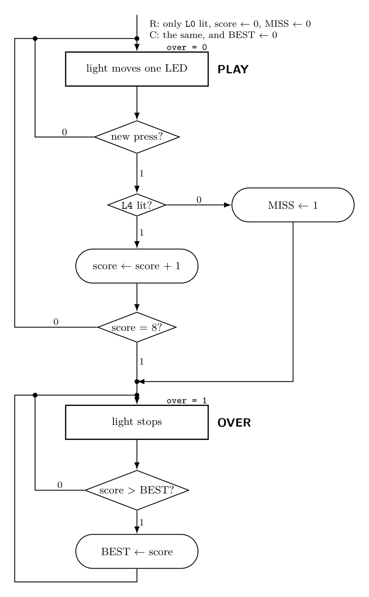
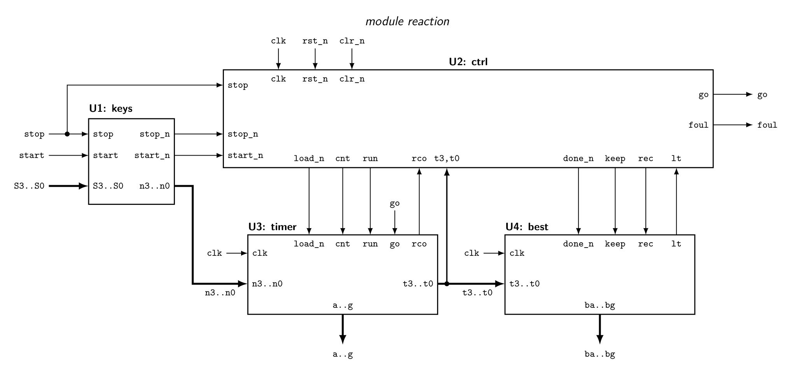
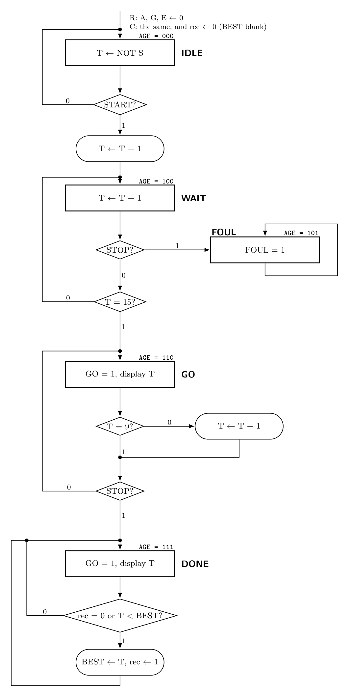

# TTL games: Stop the light and Reaction timer

F215 Digital Design capstone lab. Both games are structural Verilog built only from the 74xx chips in the lab's chip library: wires and chip instances, no `assign`, no `always`.

**Play:** [Stop the light](https://pkt5.github.io/verilog-ttl-games/) · [Reaction timer](https://pkt5.github.io/verilog-ttl-games/?game=reaction)

The page is the course's TTL Game Bench. It loads the matching file from `src/` and builds it, so the console is on as soon as the page opens.

| Game | Verilog | Chips | Blocks |
|---|---|---|---|
| Stop the light | [`src/stoplight.v`](src/stoplight.v) | 11 | 4 |
| Reaction timer | [`src/reaction.v`](src/reaction.v) | 12 | 4 |

Keys in both games: **R** new round, **C** clear all, **P** pause, **.** one tick while paused.

## Stop the light

**Space** is HIT. Press it while L4 is lit to score, anywhere else and it is a miss. Nine points wins.



| Block | Chips | Job |
|---|---|---|
| U1 ctrl | 7474, 7400, 7402 | One flip-flop holds HIT from the last tick, so `press` is 1 for one tick per push. The other holds MISS. `over` = MISS or score 9. |
| U2 ring | 74173 ×2, 7404 | An 8-bit ring of two 4-bit registers. The first bit is stored inverted, so clearing both on R leaves only L0 lit. `over` freezes the ring. |
| U3 score | 74163, 7447 | Counts with ENP = `press`, ENT = `L4`, so only a press on L4 scores. |
| U4 best | 74163, 7485, 7447 | The 7485 gives `gt` (score > BEST). BEST loads when `over` and `gt` are both 1. Only C clears it. |

Once the round is over, the HIT flip-flop is held at 1 (PRE_n = not over), so further presses are ignored until R.



## Reaction timer

Set a delay of 1 to 15 ticks on S3–S0 with keys **1–4**. **S** is START, **Space** is STOP.



| Block | Chips | Job |
|---|---|---|
| U1 keys | 7404 | Inverts S3–S0, START and STOP. |
| U2 ctrl | 7474 ×2, 7400, 7410, 7402 | State flip-flops A (started), G (GO), E (ended), and rec (a time has been recorded since C). |
| U3 timer | 74163, 7408, 7447 | One counter for both the delay and the reaction time. The 7408 passes the count to the display only while GO is lit. |
| U4 best | 74173, 7485, 7447 | Loads the time when the round ends with a faster time, or with no time recorded yet. Blank until then (BI_n = rec). |

How the timer works: before START the counter loads NOT S, which is 15 − S. It counts from the START tick, so it reaches 15 exactly S ticks later. RCO = 1 sets GO, and on the same tick the count rolls over to 0. From there the same counter counts the reaction time, and stops at 9.

STOP after START sets E. E without GO is a FOUL. GO only sets when STOP is not down on that tick, so a STOP on the tick GO would light is a FOUL. STOP before START is ignored because E needs A.



## Files

```
index.html   TTL Game Bench, loads src/*.v on open
src/         the two games
docs/        TikZ sources of the charts
images/      the charts as PNG
```

## Checks

Both games were run on the bench engine against every rule in the manual. Both sample rounds in the manual's timing diagrams match tick for tick. Reaction timer was also checked for all 15 delays, a STOP on the GO tick, the stop at 9, BEST with faster and slower times, R and C.
